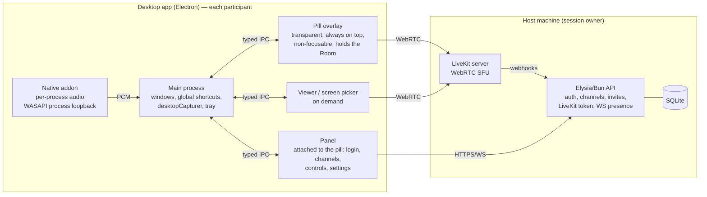
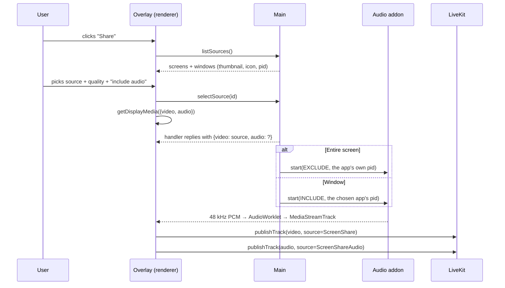

# 02 — Architecture

## Overview



**Principle:** the client never talks media with the API. The API only **authenticates and issues tokens**. Media (voice, screen, screen audio) goes straight to LiveKit. That's why moving to the cloud is just a matter of changing URLs: the API goes to a server, LiveKit goes to LiveKit Cloud or a cluster.

## Decision: Electron vs Tauri

| Criterion | Electron | Tauri |
|---|---|---|
| Screen/window capture with our own picker (no tabs) | **[Verified]** `desktopCapturer.getSources({ types: ['screen','window'] })` + `session.setDisplayMediaRequestHandler`. Browser tabs don't exist in this API, so the "no tabs" rule comes for free | Depends on each system's webview `getDisplayMedia`. **[Verified]** Issue #2600 shows failures on macOS (WKWebView) and WebRTC off by default on Linux (WebKitGTK), with no settled fix |
| System audio for the entire screen | **[Verified]** `callback({ video, audio: 'loopback' })` | No consistent path through the webview; it would need native capture in Rust |
| Audio from one app only | Native addon (WASAPI process loopback) → audio track | Same addon in Rust, but then video and WebRTC would also have to move to Rust (LiveKit Rust SDK) |
| Weight | Bigger (ships Chromium); Discord itself is Electron | Much smaller |
| Transparent overlay + click-through | `transparent`, `alwaysOnTop`, `setIgnoreMouseEvents(true, { forward: true })` | Has equivalents |
| Hide the overlay from your own capture | **[Verified]** `win.setContentProtection(true)`, which uses capture exclusion on Windows 10 2004+ | Has `set_content_protected` |
| Effort to the MVP | **Low/medium** | **High** (native capture + WebRTC) |

**[Decision] Electron for the MVP.** The required features (screen + audio + app choice + no tabs) come with ready-made APIs. To offset the weight:

- only **3 windows**, and the viewer is only created when someone is about to watch;
- an overlay with a minimal bundle (its own route and lazy loading, without loading settings screens);
- `backgroundThrottling` on for hidden windows; no polling in the renderer;
- package with ASAR and `electron-builder` (NSIS), excluding devDependencies;
- **a RAM/CPU budget measured in Phase 0** and tracked every phase.

**Door left open for Tauri:** all UI lives in `packages/ui` and the call logic in `packages/shared`, importing nothing from Electron. System access goes through a `PlatformBridge` interface (preload). If migrating is ever worth it, only the bridge implementation changes.

## Monorepo

```
sharescreen/
├─ apps/
│  ├─ desktop/            # Electron + electron-vite + React
│  │  ├─ src/main/        # windows, tray, shortcuts, capture, IPC, host mode
│  │  ├─ src/preload/     # PlatformBridge exposed through contextBridge
│  │  ├─ src/renderer/
│  │  │  ├─ pill/         # always-visible overlay
│  │  │  ├─ panel/        # panel attached to the pill (login, channels, controls, settings)
│  │  │  ├─ picker/       # screen picker
│  │  │  └─ viewer/       # watching a stream
│  │  └─ native/          # per-process audio addon (napi-rs or C++ N-API)
│  └─ api/                # Elysia + Bun
│     ├─ src/routes/      # auth, users, channels, invites, livekit
│     ├─ src/ws/          # presence
│     └─ src/db/          # Drizzle schema + migrations
├─ packages/
│  ├─ ui/                 # CSS tokens, components (Avatar, Pill, IconButton…)
│  ├─ shared/             # types, schemas (zod/typebox), API client, call store
│  └─ config/             # tsconfig, eslint, prettier
├─ infra/
│  ├─ livekit.yaml        # local config
│  └─ docker-compose.yml  # api + livekit for those who prefer Docker
├─ docs/
├─ turbo.json
└─ package.json
```

## Client components

> **Overlay-first:** there is no main window. Everything lives in the **pill** and the **panel** attached to it. Window options, click, focus and position rules are in [09-overlay-study-opencluely](09-overlay-study-opencluely.md#3-overlay-architecture-in-sharescreen).

### Main process
- **WindowManager:** pill and panel created at startup (the panel hidden); picker and viewer on demand. It also handles content-based resizing, the panel attached to the pill, anchors and the saved position per monitor, and the `screen-saver` top level reinforced on events (no polling).
- **CaptureService:** lists sources (`screen` + `window`, with thumbnails and icons), registers the `setDisplayMediaRequestHandler` and hands over the source chosen in our own picker.
- **AppAudioService:** turns the native addon on and off and forwards the PCM to the renderer (MessagePort/SharedArrayBuffer).
- **HotkeyService:** `globalShortcut` for mute, deafen and show/hide overlay. **[Hypothesis]** Push to talk needs "key down/up", and `globalShortcut` only reports the key press. Evaluate a native keyboard hook (e.g. `uiohook-napi`) in the spike. (Settled in M11: `GetAsyncKeyState` through koffi, see [10-next-steps](10-next-steps.md).)
- **HostService:** starts and stops `livekit-server` and the API as child processes (host mode).
- **Tray:** tray icon with status, show window, quit.

### Renderer
- **CallStore** (Zustand): room state (participants, speaking, muted, streaming), synced between windows through main (BroadcastChannel or IPC).
- **LiveKitSession:** a single `livekit-client` `Room`, which lives in the **pill window** (it stays open for the whole call, with `backgroundThrottling: false`). The other windows only read state and send commands.
  **[Hypothesis]** Keeping the `Room` in the overlay avoids duplicate connections. The viewer needs to receive the remote video track; the simplest alternative is for the viewer to open a second **subscribe-only** connection with a token that can't publish. Decide in Spike 2. (Settled: the viewer has its own hidden connection.)

### Electron security (required)
`contextIsolation: true`, `sandbox: true`, `nodeIntegration: false`, a strict CSP and IPC with allowlisted channels and validated payloads.

## Screen sharing: technical flow



**Why the native addon, and not just `audio: 'loopback'`:**
- System loopback captures **everything** playing on the PC, including the **call's own voices**. Viewers would hear themselves (echo). **[Hypothesis]** Confirm in Spike 3 whether Chromium/Electron already excludes its own process on Windows.
- To "share only one app with its audio", Windows 10 2004+ has WASAPI **process loopback** activation (`AUDIOCLIENT_ACTIVATION_TYPE_PROCESS_LOOPBACK`), with a mode to **include** or **exclude** a process tree. **[Verified]** The enum exists in Microsoft's documentation. The `loopback-capture` package (MIT, N-API) already captures by PID on Windows 10 2004+. **[Hypothesis]** Check whether it has the exclude mode; if not, fork it or write our own addon with napi-rs.
- **MVP plan B:** if the addon is late, use `audio: 'loopback'` for the entire screen and **disable audio** for a window, with a notice in the UI.

**Quality (presets) [Decision]:**

| Preset | Resolution | FPS | `contentHint` | Use |
|---|---|---|---|---|
| Text/code | 1080p | 15 | `detail` | sharpness |
| Default | 720p | 30 | `motion` | balance |
| Game | 1080p | 30 (60 after the MVP) | `motion` | movement |

> The presets today are four (Light & smooth, Balanced, Games and video, Smooth up to 1080p60); see [10-next-steps](10-next-steps.md).

Simulcast is on for the video track. Viewers use `adaptiveStream`, and screen tracks are **not** subscribed automatically: only whoever opens the viewer receives them, to save the host's upload.

## Backend (apps/api)

### Data model (Drizzle/SQLite)

```
users            id, username (unique), email (unique), password_hash, display_name,
                 avatar_path, created_at, updated_at
memberships      user_id, role ('owner'|'admin'|'member'), joined_at, banned_at
channels         id, name, position, user_limit (nullable), created_by, created_at
invites          code, created_by, max_uses, uses, expires_at, revoked_at
refresh_tokens   id, user_id, token_hash, expires_at, revoked_at, user_agent
user_settings    user_id, json (devices, shortcuts, overlay) — optional, also kept locally
```

Presence (who is in which channel, who is speaking) **doesn't go to the database**: it stays in memory in the API, fed by LiveKit webhooks (`participant_joined`, `participant_left`, `track_published`, `track_unpublished`) and relayed over WebSocket.

### Endpoints

> **Today (M1–M11):** `GET /health`, `GET /info`, `POST /join { name, viewer? }` (open join to the "General" channel), `/avatar`, `/me`, `/moderate`, `/pointer`, `/chat/*` and `/session/*`. See [14-security](14-security.md). The table below is the M3 target.

| Method | Route | Description |
|---|---|---|
| POST | `/auth/register` | creates an account (only with a valid invite, except the first user, who becomes owner) |
| POST | `/auth/login` | returns an access token (short JWT) + refresh token |
| POST | `/auth/refresh` | renews the access token (refresh rotation) |
| POST | `/auth/logout` | revokes the refresh token |
| GET/PATCH | `/me` | profile |
| POST | `/me/avatar` | upload (resizes to 128/256 px, webp) |
| GET | `/channels` | list + current participants |
| POST/PATCH/DELETE | `/channels/:id` | admin |
| POST | `/channels/:id/join` | checks permission → `{ livekitUrl, token }` |
| POST | `/invites` · GET `/invites/:code` | creates / looks up an invite |
| POST | `/livekit/webhook` | receives LiveKit events (checks the signature) |
| WS | `/ws` | events: `presence.snapshot`, `channel.updated`, `participant.joined/left/updated`, `stream.started/stopped` |

**LiveKit token:** `room = channel.id`, `identity = user.id`, `name = display_name`, metadata `{ avatarUrl }`, `canPublishSources: ['microphone','screen_share','screen_share_audio']` and a short validity.

Passwords with `Bun.password.hash` (argon2id). Rate limit on `/auth/*`.

## Host mode (self-hosted by the session owner)

1. The host clicks **"Create my server"** in the app.
2. The main process starts `livekit-server` (binary included in the installer) and the API (`bun build --compile`, a single `.exe`), each with keys generated on the spot and saved in `%APPDATA%/Accord/host/`.
3. The app shows the **address** and an **invite link** `sharescreen://join?host=…&code=…`.
4. Participants open the link (protocol registered by the app) → sign-up/login screen for that server.

> What shipped is simpler: Channels → Host starts the server, and invites use `accord://join?h=…&n=…&k=…` with a revocable invite key (M10/M11).

**Access from outside the host's network** (the biggest risk, see [06-risks](06-risks.md)):

| Mode | How | For whom | MVP |
|---|---|---|---|
| LAN | `--bind 0.0.0.0`, same Wi-Fi | testing, same house | ✅ |
| Mesh VPN (Tailscale/ZeroTier) | everyone on the same virtual network; the host shares the VPN IP | group of friends, no router changes | ✅ recommended |
| Port forwarding | open TCP 7880 (API/signaling), TCP 7881 (ICE/TCP) and UDP 7882 (UDP mux) on the router | people who can configure their router | ✅ documented |
| VPS / cloud | API + LiveKit on a VPS with a domain and TLS, or LiveKit Cloud | scale | after the MVP |

**[Decision]** In host mode, use **UDP mux on a single port (7882)** instead of the 50000–60000 range. That simplifies port forwarding. **[Verified]** When `rtc.udp_port` is set, the port range isn't used.

## Migrating to a scalable server

1. API: SQLite → Postgres (Drizzle swaps the driver) and avatars → S3-compatible storage.
2. In-memory presence → Redis (pub/sub) to run several API instances.
3. LiveKit → LiveKit Cloud **or** our own cluster (LiveKit + Redis), with TLS and a domain.
4. The client doesn't change: it only reads `apiUrl` and the `livekitUrl` returned by `/join`.
5. Multi-server (several "servers" per account) comes in here, with a `servers` table and `server_id` on channels/members.
