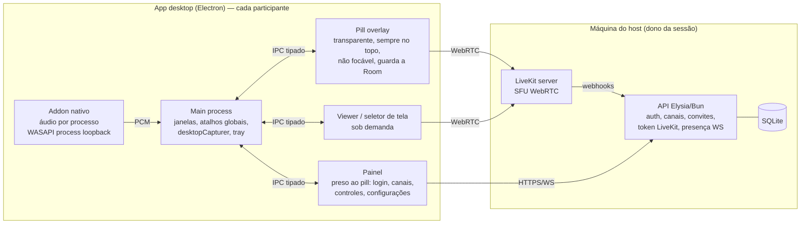
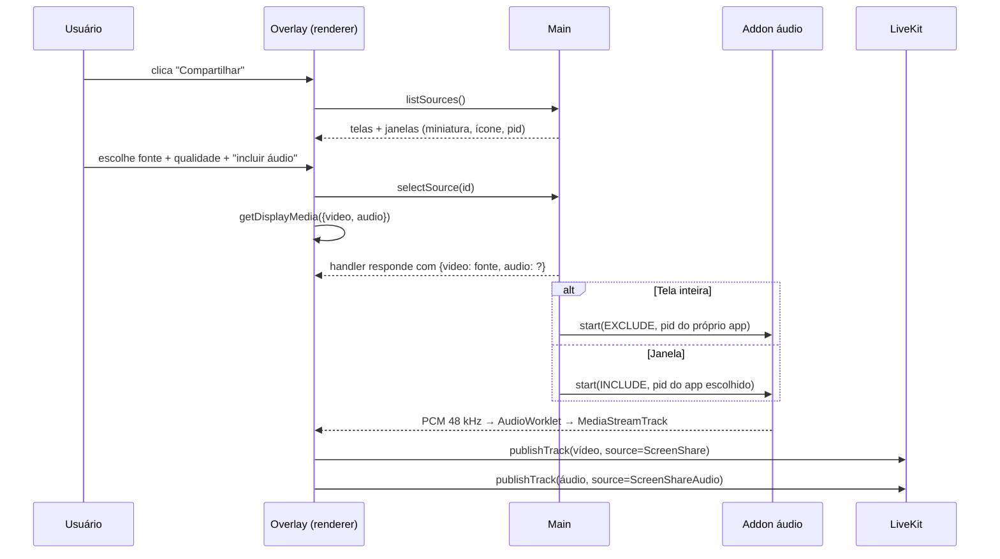

# 02 — Arquitetura

## Visão geral



**Princípio:** o cliente nunca fala de mídia com a API. A API só **autentica e emite tokens**. A mídia (voz, tela, áudio da tela) vai direto para o LiveKit. Por isso a migração para nuvem é só trocar URLs: a API vai para um servidor, o LiveKit vai para o LiveKit Cloud ou para um cluster.

## Decisão: Electron vs Tauri

| Critério | Electron | Tauri |
|---|---|---|
| Captura de tela/janela com seletor próprio (sem guias) | **[Verificado]** `desktopCapturer.getSources({ types: ['screen','window'] })` + `session.setDisplayMediaRequestHandler`. Guias de navegador não existem nessa API, então a restrição "sem guia" sai de graça | Depende do `getDisplayMedia` do webview de cada sistema. **[Verificado]** O issue #2600 mostra falhas no macOS (WKWebView) e WebRTC desligado por padrão no Linux (WebKitGTK), sem solução fechada |
| Áudio do sistema na tela inteira | **[Verificado]** `callback({ video, audio: 'loopback' })` | Não há caminho consistente pelo webview; exigiria captura nativa em Rust |
| Áudio só de um app | Addon nativo (WASAPI process loopback) → track de áudio | Mesmo addon em Rust, mas aí vídeo e WebRTC também teriam de ir para o Rust (LiveKit Rust SDK) |
| Peso | Maior (traz o Chromium); o próprio Discord é Electron | Bem menor |
| Overlay transparente + click-through | `transparent`, `alwaysOnTop`, `setIgnoreMouseEvents(true, { forward: true })` | Tem equivalentes |
| Ocultar overlay da própria captura | **[Verificado]** `win.setContentProtection(true)`, que no Windows 10 2004+ usa exclusão de captura | Tem `set_content_protected` |
| Esforço até o MVP | **Baixo/médio** | **Alto** (captura + WebRTC nativos) |

**[Decisão] Electron no MVP.** As funcionalidades obrigatórias (tela + áudio + escolha de app + sem guia) saem com APIs prontas. Para compensar o peso:

- só **3 janelas**, e o viewer só é criado quando alguém vai assistir;
- overlay com bundle mínimo (rota própria e lazy load, sem carregar telas de configuração);
- `backgroundThrottling` ligado nas janelas ocultas; nada de polling no renderer;
- empacotar com ASAR e `electron-builder` (NSIS), excluindo devDependencies;
- **orçamento de RAM/CPU medido na Fase 0** e acompanhado a cada fase.

**Porta aberta para o Tauri:** toda a UI fica em `packages/ui` e a lógica de chamada em `packages/shared`, sem importar nada do Electron. O acesso ao sistema passa por uma interface `PlatformBridge` (preload). Se um dia valer migrar, troca-se só a implementação do bridge.

## Monorepo

```
sharescreen/
├─ apps/
│  ├─ desktop/            # Electron + electron-vite + React
│  │  ├─ src/main/        # janelas, tray, atalhos, captura, IPC, host mode
│  │  ├─ src/preload/     # PlatformBridge exposto via contextBridge
│  │  ├─ src/renderer/
│  │  │  ├─ pill/         # overlay sempre visível
│  │  │  ├─ panel/        # painel preso ao pill (login, canais, controles, settings)
│  │  │  ├─ picker/       # seletor de tela
│  │  │  └─ viewer/       # assistir transmissão
│  │  └─ native/          # addon de áudio por processo (napi-rs ou C++ N-API)
│  └─ api/                # Elysia + Bun
│     ├─ src/routes/      # auth, users, channels, invites, livekit
│     ├─ src/ws/          # presença
│     └─ src/db/          # Drizzle schema + migrations
├─ packages/
│  ├─ ui/                 # tokens CSS, componentes (Avatar, Pill, IconButton…)
│  ├─ shared/             # tipos, schemas (zod/typebox), cliente da API, store da chamada
│  └─ config/             # tsconfig, eslint, prettier
├─ infra/
│  ├─ livekit.yaml        # config local
│  └─ docker-compose.yml  # api + livekit para quem preferir Docker
├─ docs/
├─ turbo.json
└─ package.json
```

## Componentes do cliente

> **Overlay-first:** não há janela principal. Tudo vive no **pill** e no **painel** preso a ele. Opções de janela, regras de clique, foco e posição estão em [09-estudo-overlay-opencluely](09-estudo-overlay-opencluely.md#3-arquitetura-do-overlay-no-sharescreen).

### Main process
- **WindowManager:** pill e painel criados no início (o painel oculto); seletor e viewer sob demanda. Também cuida do redimensionamento pelo conteúdo, do painel preso ao pill, das âncoras e da posição salva por monitor, e do topo `screen-saver` reforçado por evento (sem polling).
- **CaptureService:** lista as fontes (`screen` + `window`, com miniaturas e ícones), registra o `setDisplayMediaRequestHandler` e entrega a fonte escolhida no seletor próprio.
- **AppAudioService:** liga e desliga o addon nativo e repassa o PCM ao renderer (MessagePort/SharedArrayBuffer).
- **HotkeyService:** `globalShortcut` para mutar, ensurdecer e mostrar/ocultar o overlay. **[Hipótese]** Push-to-talk precisa de "tecla pressionada/solta", e o `globalShortcut` só avisa quando a tecla é pressionada. Avaliar um hook de teclado nativo (ex.: `uiohook-napi`) no spike.
- **HostService:** sobe e derruba `livekit-server` e a API como processos filhos (host mode).
- **Tray:** ícone na bandeja com status, mostrar janela, sair.

### Renderer
- **CallStore** (Zustand): estado da sala (participantes, falando, mudo, transmitindo), sincronizado entre janelas via main (BroadcastChannel ou IPC).
- **LiveKitSession:** uma única `Room` do `livekit-client`, que vive na **janela do pill** (ela fica aberta durante toda a chamada, com `backgroundThrottling: false`). As outras janelas só leem o estado e mandam comandos.
  **[Hipótese]** Manter a `Room` na overlay evita duplicar conexões. O viewer precisa receber a track remota de vídeo; a alternativa mais simples é o viewer abrir uma segunda conexão **só de assinatura** com token sem permissão de publicar. Decidir no Spike 2.

### Segurança Electron (obrigatório)
`contextIsolation: true`, `sandbox: true`, `nodeIntegration: false`, CSP restritiva e IPC com canais em allowlist e payload validado.

## Compartilhamento de tela: fluxo técnico



**Por que o addon nativo, e não só `audio: 'loopback'`:**
- O loopback do sistema captura **tudo** o que toca no PC, inclusive as **vozes da própria chamada**. Os espectadores ouviriam a si mesmos (eco). **[Hipótese]** Confirmar no Spike 3 se o Chromium/Electron já exclui o próprio processo no Windows.
- Para "compartilhar só um app com o som dele", o Windows 10 2004+ tem a ativação **process loopback** do WASAPI (`AUDIOCLIENT_ACTIVATION_TYPE_PROCESS_LOOPBACK`), com modo de **incluir** ou **excluir** uma árvore de processos. **[Verificado]** O enum existe na documentação da Microsoft. O pacote `loopback-capture` (MIT, N-API) já faz captura por PID no Windows 10 2004+. **[Hipótese]** Ver se ele tem o modo excluir; se não tiver, fazer fork ou escrever um addon próprio com napi-rs.
- **Plano B do MVP:** se o addon atrasar, usar `audio: 'loopback'` na tela inteira e **desabilitar áudio** na janela, com aviso na UI.

**Qualidade (presets) [Decisão]:**

| Preset | Resolução | FPS | `contentHint` | Uso |
|---|---|---|---|---|
| Texto/código | 1080p | 15 | `detail` | nitidez |
| Padrão | 720p | 30 | `motion` | equilíbrio |
| Jogo | 1080p | 30 (60 pós-MVP) | `motion` | movimento |

Simulcast ligado na track de vídeo. Os espectadores usam `adaptiveStream`, e as tracks de tela **não** são assinadas automaticamente: só quem abre o viewer recebe, para poupar o upload do host.

## Backend (apps/api)

### Modelo de dados (Drizzle/SQLite)

```
users            id, username (único), email (único), password_hash, display_name,
                 avatar_path, created_at, updated_at
memberships      user_id, role ('owner'|'admin'|'member'), joined_at, banned_at
channels         id, name, position, user_limit (nullable), created_by, created_at
invites          code, created_by, max_uses, uses, expires_at, revoked_at
refresh_tokens   id, user_id, token_hash, expires_at, revoked_at, user_agent
user_settings    user_id, json (dispositivos, atalhos, overlay) — opcional, também fica local
```

A presença (quem está em qual canal, quem está falando) **não vai para o banco**: fica em memória na API, alimentada pelos webhooks do LiveKit (`participant_joined`, `participant_left`, `track_published`, `track_unpublished`) e repassada por WebSocket.

### Endpoints

> **Hoje (M1–M6):** só `GET /health` e `POST /join { name, viewer? }` (entrada aberta no canal "Geral"). A tabela abaixo é o alvo do M3.

| Método | Rota | Descrição |
|---|---|---|
| POST | `/auth/register` | cria conta (só com convite válido, exceto o primeiro usuário, que vira owner) |
| POST | `/auth/login` | devolve access token (JWT curto) + refresh token |
| POST | `/auth/refresh` | renova o access token (rotação do refresh) |
| POST | `/auth/logout` | revoga o refresh |
| GET/PATCH | `/me` | perfil |
| POST | `/me/avatar` | upload (redimensiona para 128/256 px, webp) |
| GET | `/channels` | lista + participantes atuais |
| POST/PATCH/DELETE | `/channels/:id` | admin |
| POST | `/channels/:id/join` | valida permissão → `{ livekitUrl, token }` |
| POST | `/invites` · GET `/invites/:code` | cria / consulta convite |
| POST | `/livekit/webhook` | recebe eventos do LiveKit (valida assinatura) |
| WS | `/ws` | eventos: `presence.snapshot`, `channel.updated`, `participant.joined/left/updated`, `stream.started/stopped` |

**Token LiveKit:** `room = channel.id`, `identity = user.id`, `name = display_name`, metadata `{ avatarUrl }`, `canPublishSources: ['microphone','screen_share','screen_share_audio']` e validade curta.

Senhas com `Bun.password.hash` (argon2id). Rate limit em `/auth/*`.

## Host mode (self-hosted pelo dono da sessão)

1. O host clica em **"Criar meu servidor"** no app.
2. O main process sobe `livekit-server` (binário incluído no instalador) e a API (`bun build --compile`, vira um `.exe` único), cada um com chaves geradas na hora e salvas em `%APPDATA%/Accord/host/`.
3. O app mostra o **endereço** e um **link de convite** `sharescreen://join?host=…&code=…`.
4. Os participantes abrem o link (protocolo registrado no app) → tela de cadastro/login daquele servidor.

**Acesso de fora da rede do host** (o maior risco, ver [06-riscos](06-riscos.md)):

| Modo | Como | Para quem | MVP |
|---|---|---|---|
| LAN | `--bind 0.0.0.0`, mesmo Wi-Fi | testes, mesma casa | ✅ |
| VPN mesh (Tailscale/ZeroTier) | todos na mesma rede virtual; o host informa o IP da VPN | grupo de amigos, sem mexer no roteador | ✅ recomendado |
| Encaminhamento de portas | abrir TCP 7880 (API/sinalização), TCP 7881 (ICE/TCP) e UDP 7882 (UDP mux) no roteador | quem sabe configurar o roteador | ✅ documentado |
| VPS / nuvem | API + LiveKit numa VPS com domínio e TLS, ou LiveKit Cloud | escala | pós-MVP |

**[Decisão]** No host mode, usar **UDP mux numa porta só (7882)** em vez da faixa 50000–60000. Isso simplifica o encaminhamento. **[Verificado]** Quando `rtc.udp_port` está definido, a faixa de portas não é usada.

## Migração para servidor escalonável

1. API: SQLite → Postgres (o Drizzle troca o driver) e avatares → armazenamento S3-compatível.
2. Presença em memória → Redis (pub/sub) para rodar várias instâncias da API.
3. LiveKit → LiveKit Cloud **ou** cluster próprio (LiveKit + Redis), com TLS e domínio.
4. O cliente não muda: só lê `apiUrl` e o `livekitUrl` devolvido pelo `/join`.
5. Multi-servidor (vários "servidores" por conta) entra aqui, com uma tabela `servers` e `server_id` em canais/membros.
